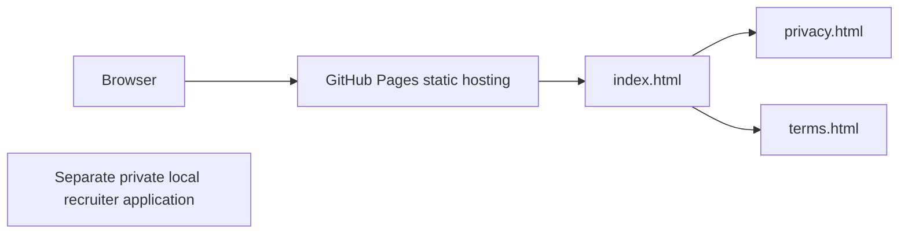

# Recruiter application information site

This GitHub Pages repository contains static information, privacy and terms pages for a personal recruiter automation application. The mailbox engine and its credentials are not hosted here.

## Architecture



The disconnected application node is intentional: these static pages do not call Gmail, Microsoft Graph or a model. They describe the separate personal application rather than implement its automation.

## Preview from a clean checkout

No package installation or account credentials are required. With Python 3 installed:

```sh
python3 -m http.server 8765 --bind 127.0.0.1
```

Open `http://127.0.0.1:8765/`, then follow the privacy and terms links. Check the displayed content against actual application behavior before publishing a disclosure update. A static page or policy document is not proof of compliance or a backend security control.
